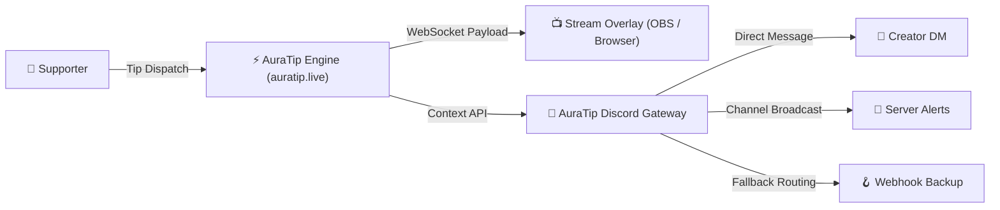

<div align="center">

  <!-- ======================================================== -->
  <!-- CYBERPUNK HUD TYPING HEADER                              -->
  <!-- ======================================================== -->
  <a href="https://github.com/GR8ANSH">
    
  </a>

  <!-- ======================================================== -->
  <!-- SYSTEM STATUS BADGES & TELEMETRY PILLS                   -->
  <!-- ======================================================== -->
  <p align="center">
    <a href="https://github.com/GR8ANSH">
      
    </a>
    <a href="https://auratip.live">
      
    </a>
    <a href="https://github.com/GR8ANSH">
      
    </a>
    <a href="mailto:greatansh10@gmail.com">
      
    </a>
  </p>

  <!-- ======================================================== -->
  <!-- ANIMATED PULSING LASER SEPARATOR                         -->
  <!-- ======================================================== -->
  

  <!-- ======================================================== -->
  <!-- QUICK NAVIGATION HUD                                     -->
  <!-- ======================================================== -->
  <p align="center">
    <a href="#-system-telemetry--diagnostics"><code>[ ⚡ TELEMETRY ]</code></a> &nbsp;•&nbsp;
    <a href="#-flagship-deployments--expeditions"><code>[ 🚀 EXPEDITIONS ]</code></a> &nbsp;•&nbsp;
    <a href="#-the-arsenal--tech-matrix"><code>[ 🛠️ ARSENAL ]</code></a> &nbsp;•&nbsp;
    <a href="#-live-telemetry--github-metrics"><code>[ 📊 METRICS ]</code></a> &nbsp;•&nbsp;
    <a href="#-quantum-grid-snake"><code>[ 🐍 GRID SNAKE ]</code></a> &nbsp;•&nbsp;
    <a href="#-transmission-frequencies"><code>[ 📡 TRANSMISSIONS ]</code></a>
  </p>

</div>

<br />

<!-- ======================================================== -->
<!-- SECTION: SYSTEM TELEMETRY / ABOUT ME TERMINAL            -->
<!-- ======================================================== -->
## ⚡ System Telemetry // Diagnostics

```yaml
╭──────────────────────────────────────────────────────────────────────────────╮
│  OPERATOR     : Ansh Singh (GR8ANSH)                                         │
│  SECURITY LVL : Level-5 Full-Stack Engineer & Systems Architect              │
│  DOMAIN       : High-Throughput Web, Microservices & Real-Time Event Meshes  │
│  CORE MISSION : Architecting resilient, sub-second creator economies         │
│  CURRENT OPS  : Scaling AuraTip (https://auratip.live) & Discord Bot Nodes   │
│  WEAPONS      : TypeScript • Node.js • Express • React • Prisma • WebSockets │
│  DATA CORE    : PostgreSQL • MongoDB • Redis • JSON Audit Streams            │
│  LOCATION     : India [IN] // GMT+05:30                                      │
│  DIRECTIVE    : "Ship relentlessly. Benchmark obsessively. Zero latency."    │
╰──────────────────────────────────────────────────────────────────────────────╯
```

### 🛰️ Operator Briefing
I'm **Ansh Singh**, a software engineer and builder driven by high-concurrency systems, interactive interfaces, and developer-grade tooling. 

- 🌌 **Founder & Architect** of **[AuraTip](https://auratip.live)** — powering next-gen live streaming monetization with instantaneous tip alerts, automated creator onboarding, and responsive dashboards.
- ⚡ **Real-Time Specialist** — building resilient event backbones using WebSockets, Gateway APIs, and pub-sub pipelines that never drop a packet.
- 🛠️ **Full-Stack Mastery** — comfortable anywhere between raw database indexes and pixel-perfect neon responsive UI.
- 🎯 **Continuous Optimization** — obsessed with sub-millisecond execution times, clean architecture, and bulletproof API contracts.

<br />

<!-- ======================================================== -->
<!-- SECTION: FLAGSHIP PROJECTS & EXPEDITIONS                 -->
<!-- ======================================================== -->
## 🚀 Flagship Deployments // Expeditions

<table>
  <tr>
    <td width="50%" valign="top">
      <h3 align="center">⚡ AuraTip Platform</h3>
      <p align="center">
        <a href="https://auratip.live">
          
        </a>
      </p>
      <p>
        <strong>Next-Gen Creator Monetization & Live Alert Engine</strong><br />
        Engineered for streamers and creators to accept instant tipping with zero friction, multi-tiered visual aura notifications, and live stream overlay sync.
      </p>
      <ul>
        <li>⚡ <b>Sub-second alert dispatch</b> to OBS / Streamlabs overlays via WebSockets</li>
        <li>🛡️ <b>Secure creator payouts</b> and transaction verification pipelines</li>
        <li>🎨 <b>Dynamic Aura themes</b> responsive to tip volume and user tiers</li>
      </ul>
      <p>
        
        
        
        
      </p>
    </td>
    <td width="50%" valign="top">
      <h3 align="center">🤖 AuraTip Discord Gateway</h3>
      <p align="center">
        <a href="https://github.com/GR8ANSH/Auratip-Discord-Bot">
          
        </a>
      </p>
      <p>
        <strong>Official Discord Automation & Creator Gateway</strong><br />
        Intelligent multi-tier dispatch bot that connects the AuraTip tipping engine directly into Discord communities and creator servers.
      </p>
      <ul>
        <li>🔐 <b>Personal DM Onboarding</b> — delivers credentials via encrypted DM</li>
        <li>🎯 <b>Username Resolution</b> — maps handles to Discord Snowflake IDs</li>
        <li>📢 <b>Smart Dispatch Engine</b> — DM → Channel → Webhook failover routing</li>
        <li>📜 <b>Persistent JSON Audit Logging</b> for tamper-evident dispatch history</li>
      </ul>
      <p>
        
        
        
        
      </p>
    </td>
  </tr>
</table>

<details>
  <summary><b>🔍 Tap to inspect AuraTip Core Architecture & Technical Flow</b></summary>
  <br />


</details>

<br />

<!-- ======================================================== -->
<!-- SECTION: TECHNICAL ARSENAL / SKILL MATRIX                -->
<!-- ======================================================== -->
## 🛠️ The Arsenal // Tech Matrix

<div align="center">

### 💻 Core Programming Languages
<p>
  
  
  
  
  
  
  
  
</p>

### ⚙️ Backend, APIs & Real-Time Engine
<p>
  
  
  
  
  
  
</p>

### 🎨 Frontend & Interface Engineering
<p>
  
  
  
  
  
</p>

### 🗄️ Database & Storage Layer
<p>
  
  
  
  
  
</p>

### ☁️ Cloud, DevOps & Environments
<p>
  
  
  
  
  
  
  
</p>

</div>

<br />

<!-- ======================================================== -->
<!-- SECTION: DYNAMIC GITHUB TELEMETRY & STREAK CARDS         -->
<!-- ======================================================== -->
## 📊 Live Telemetry // GitHub Metrics

<div align="center">

  <table border="0">
    <tr>
      <td align="center" width="50%">
        <a href="https://github.com/GR8ANSH">
          
        </a>
      </td>
      <td align="center" width="50%">
        <a href="https://github.com/GR8ANSH">
          
        </a>
      </td>
    </tr>
    <tr>
      <td colspan="2" align="center">
        <a href="https://github.com/GR8ANSH">
          
        </a>
      </td>
    </tr>
  </table>

</div>

<br />

<!-- ======================================================== -->
<!-- SECTION: ANIMATED CONTRIBUTION SNAKE                     -->
<!-- ======================================================== -->
## 🐍 Quantum Grid Snake // Activity Stream

<div align="center">
  <picture>
    <source media="(prefers-color-scheme: dark)" srcset="https://raw.githubusercontent.com/GR8ANSH/GR8ANSH/output/github-contribution-grid-snake-dark.svg">
    <source media="(prefers-color-scheme: light)" srcset="https://raw.githubusercontent.com/GR8ANSH/GR8ANSH/output/github-contribution-grid-snake.svg">
    
  </picture>
  <p><sub><i>Automated via GitHub Actions • Consuming commits across the space-time grid</i></sub></p>
</div>

<br />

<!-- ======================================================== -->
<!-- SECTION: CYBERPUNK TERMINAL PHILOSOPHY                   -->
<!-- ======================================================== -->
## 💡 Developer Protocol // Philosophy

<div align="center">
  <a href="https://github.com/GR8ANSH">
    
  </a>
</div>

<br />

<!-- ======================================================== -->
<!-- SECTION: TRANSMISSION FREQUENCIES / CONNECT              -->
<!-- ======================================================== -->
## 📡 Transmission Frequencies // Open Comms

<div align="center">
  <p>Got a challenging architecture, an ambitious project, or want to collaborate on high-scale systems? Connect through the network:</p>
  
  <p>
    <a href="mailto:greatansh10@gmail.com" target="_blank">
      
    </a>
    &nbsp;
    <a href="https://github.com/GR8ANSH" target="_blank">
      
    </a>
    &nbsp;
    <a href="https://auratip.live" target="_blank">
      
    </a>
    &nbsp;
    <a href="https://discord.com" target="_blank">
      
    </a>
  </p>
  
  <br />
  
  

  <p align="center">
    <sub><b>SYSTEM GR8ANSH.SYS</b> // BUILT WITH INTENT & OBSESSIVE CRAFTSMANSHIP // 2026</sub>
  </p>
</div>
